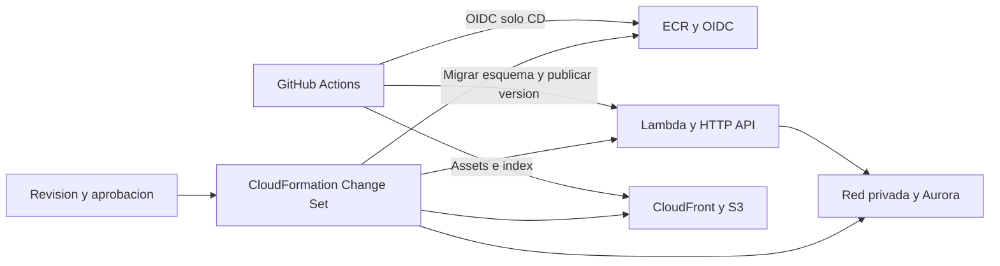
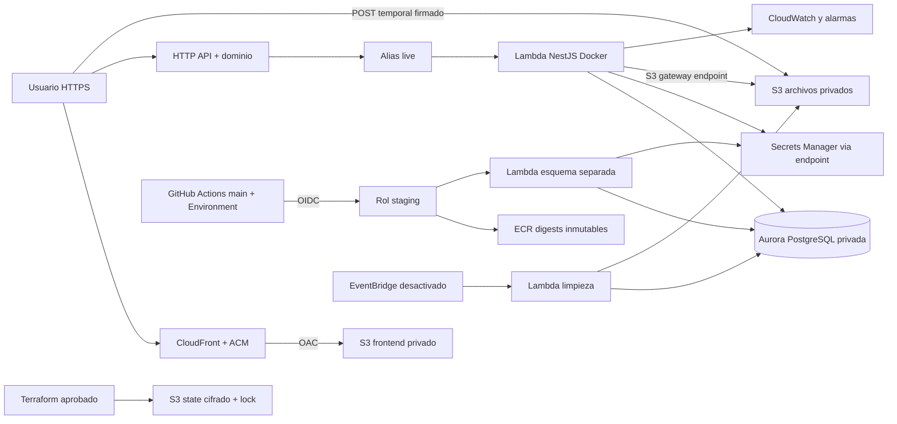

# Despliegue AWS de Cocjant

## Alcance aprobado

- Solo staging en `us-east-1`; no crear produccion.
- El presupuesto mensual es un parametro de planificacion para staging, con alertas propuestas al 50 %, 80 % y 100 %. No es una cotizacion ni un limite automatico de gasto; validar tarifas regionales y el plan antes de crear recursos. El dominio, impuestos y operaciones extraordinarias deben estimarse aparte.
- Arquitectura candidata: CloudFront y S3 para React; HTTP API y Lambda para NestJS; Aurora PostgreSQL Serverless v2; S3 privado para fotos y documentos.
- Dominio propuesto: `staging.cocjant-esp.com` y `api-staging.cocjant-esp.com`. Titularidad y DNS pendientes de verificar.
- Repositorio publico autorizado: `https://github.com/jhon0210/cocantreports.git`. La publicacion de codigo no ejecuta el despliegue AWS; CD requiere ejecucion manual y configuracion del Environment staging.
- CloudFormation reemplaza Terraform por decision del usuario. No crear recursos facturables hasta revisar el change set y los costos. No migrar datos reales ni eliminar contenidos existentes sin aprobacion especifica.

### Plan gratuito con creditos: revision previa al despliegue

Consultar de forma privada los creditos y vencimiento de la cuenta; no publicar saldos, capturas ni informacion de facturacion en Git. Segun las [preguntas oficiales de Free Tier](https://aws.amazon.com/free/free-tier-faqs/), el Free plan termina al agotarse los creditos o su periodo, lo que ocurra primero; se pierde acceso a recursos/datos y existe un plazo de recuperacion de 90 dias mediante cambio al Paid plan. Exportar respaldos antes del vencimiento; ese plazo no sustituye un respaldo externo. No se autorizo cambiar al Paid plan.

Dividir los creditos disponibles entre los dias restantes para obtener una referencia diaria compartida con cualquier otro consumo elegible de la cuenta. No es una cotizacion ni un limite automatico; el presupuesto parametrizado no garantiza llegar al vencimiento.

La [pagina oficial de precios Aurora](https://aws.amazon.com/rds/aurora/pricing/) anuncia acceso del Free plan a Aurora PostgreSQL serverless hasta 4 ACU y 1 GiB de almacenamiento por cluster. Debe confirmarse su disponibilidad y las condiciones para esta cuenta: el limite de almacenamiento puede ser relevante para el esquema y los datos. Mantener fotos/documentos en S3 no elimina el consumo del resto de PostgreSQL. La plantilla actual limita computo a 1 ACU, pero no impone un limite de almacenamiento de 1 GiB.

La configuracion actual mantiene 0.5 ACU como minimo y un endpoint Secrets Manager en dos AZ. Poco trafico no elimina esos consumos fijos; falta estimarlos con tarifas regionales y los demas servicios antes de aplicar. No se activo pausa automatica ni se cambio de arquitectura sin verificar compatibilidad y comportamiento.

AWS CLI 2.39.1 instalada en Windows admite acceso con navegador sin Identity Center ni CloudShell. La sesion IAM ya se verifico con STS en la cuenta aprobada. Para renovar el acceso cuando expire, ejecutar en **PowerShell de Windows de este mismo equipo**:

```powershell
& 'C:\Program Files\Amazon\AWSCLIV2\aws.exe' login --profile cocjant-staging --region us-east-1
& 'C:\Program Files\Amazon\AWSCLIV2\aws.exe' sts get-caller-identity --profile cocjant-staging --region us-east-1 --no-cli-pager
```

Completar la autorizacion en el navegador usando el usuario IAM de la cuenta aprobada, no root; ejecutar la segunda linea solo tras finalizar correctamente la primera. No compartir enlaces/codigos de autorizacion, tokens, claves ni cache de login. Ante denegacion revisar el error sin ampliar privilegios indiscriminadamente.

El problema DNS de HashiCorp ya no es requisito para el despliegue: el flujo activo no usa Terraform, proveedores descargados ni archivos de estado locales.

## Flujo vigente: CloudFormation y GitHub Actions

Las instrucciones Terraform al final se conservan **solo como archivo historico**, no se deben ejecutar. No se borraron los archivos anteriores: `infra/bootstrap` e `infra/staging` quedan fuera del flujo y CI no los invoca. No desplegar ambos sistemas sobre los mismos recursos.

### Plantillas y protecciones

| Stack | Plantilla | Alcance |
|---|---|---|
| `cocjant-staging-bootstrap` | [bootstrap.yml](../infra/cloudformation/bootstrap.yml) | ECR inmutable y proveedor GitHub OIDC opcional. No necesita bucket tfstate. |
| `cocjant-staging-foundation` | [foundation.yml](../infra/cloudformation/foundation.yml) | VPC, dos subredes privadas sin NAT/IGW, endpoints S3/Secrets, Aurora, buckets y secretos. |
| `cocjant-staging-application` | [application.yml](../infra/cloudformation/application.yml) | Roles separados, Lambda API/esquema/limpieza, HTTP API, ACM, CloudFront/OAC, Route53, alarmas, presupuesto y rol CD OIDC. |

Buckets, ECR, secretos, Aurora y writer usan `DeletionPolicy` y `UpdateReplacePolicy: Retain`; Aurora conserva proteccion de borrado. Esto **no protege por si solo toda la red**: no eliminar foundation mientras haya datos/recursos retenidos. Habilitar termination protection en cada stack tras su creacion y aplicar [stack-policy.json](../infra/cloudformation/stack-policy.json), que niega reemplazos y eliminaciones durante updates. Cualquier excepcion debe revisarse por separado; Retain no equivale a copia de seguridad ni detiene costos de recursos retenidos.

Las plantillas no contienen contrasenas/JWT. Secrets Manager se inicializa con `{}` no sensible: es un marcador deliberadamente incompleto, no una configuracion funcional. Un operador debe poblar valores privados y crear usuarios PostgreSQL separados por conexion privada aprobada antes de invocar API/esquema. RDS administra la contrasena master. No poner valores reales en parametros, change sets, Git, chat, logs ni variables frontend.

La API mantiene 28 s, esquema 900 s, limpieza 120 s y agenda DISABLED. Se conservan CORS exacto, TLS, descargas privadas, versiones y alias `live`. Los digests ECR deben existir antes de crear application; no hay seeders ni copia de archivos reales en el despliegue.

### Revision sin ejecutar recursos

[New-StagingChangeSet.ps1](../tools/aws/New-StagingChangeSet.ps1) verifica cuenta/identidad no root, valida la plantilla y crea un change set **sin ejecutarlo**. No tiene comando `execute-change-set`. Para CREATE, CloudFormation puede dejar un stack vacio `REVIEW_IN_PROGRESS`; no es un despliegue funcional.

Ejemplo desde PowerShell, reemplazando la cuenta y usando un archivo local de parametros:

```powershell
.\tools\aws\New-StagingChangeSet.ps1 -Stage bootstrap -AccountId '<CUENTA_APROBADA>' -ChangeSetType CREATE -ParametersFile '.\bootstrap.parameters.local.json' -AwsPath 'C:\Program Files\Amazon\AWSCLIV2\aws.exe'
```

Formato del archivo (excluido por `.gitignore`); usar `true` solo si se comprobo ausencia del proveedor y su creacion se aprueba:

```json
[
  {"ParameterKey": "CreateGithubOidcProvider", "ParameterValue": "true"}
]
```

Para foundation/application usar el mismo formato con sus parametros de plantilla. `S3PrefixListId` se obtiene de EC2 para `com.amazonaws.us-east-1.s3`. Pasar los outputs de foundation como parametros application, sin secretos. Crear change sets de uno en uno: primero bootstrap, despues foundation y finalmente application. Revisar cambios, replacements, IAM, precios y dependencias; ejecutar desde CloudFormation solo despues de la aprobacion especifica de cada change set. El script no concede permisos ni cambia el plan gratuito.

CI usa `cfn-lint` fijado en [cfn-lint-requirements.txt](../tools/aws/cfn-lint-requirements.txt), sin credenciales AWS; tambien conserva builds, pruebas, Docker y auditorias. GitHub Actions CD sigue publicando codigo con el rol OIDC limitado y Environment staging protegido; **no administra stacks**. Las operaciones de infraestructura requieren una identidad operativa separada. No se publicaron archivos Git ni se ejecutaron workflows remotos.

### Actualizaciones de infraestructura y codigo

CD actualiza imagenes Lambda y alias directamente; esas propiedades pueden aparecer como drift en CloudFormation. No usar la plantilla inicial para restaurar el codigo ni ejecutar drift remediation automatica. Antes de un UPDATE application, registrar las imagenes actuales y `live`, y suministrar `ApiImageDigest`, `MigrationImageDigest` y `LiveVersion` actuales explicitamente. El revisor consulta Lambda y rechaza valores distintos o `UsePreviousValue` en esos tres campos; tambien detiene la revision si API y limpieza tienen imagenes distintas por un CD incompleto. Mantener `InitialVersion` y su identificador logico sin cambios. Revisar el change set y evitar despliegues CD concurrentes con mantenimiento de infraestructura.

Rollback de infraestructura no revierte migraciones PostgreSQL. No modificar los marcadores de secretos mediante CloudFormation despues de poblarlos: su contenido pertenece al procedimiento privado de secretos, no al pipeline.

### Comprobaciones y pendientes actuales

- STS verifico sesion IAM no root. Free Tier confirma `FREE`, `ACTIVE`; saldo y vencimiento se consultan de forma privada.
- Route53 no devolvio zonas para el dominio. Falta crear/configurar zona y validar titularidad/delegacion antes de certificados; confirmar costo/disponibilidad del dominio y Route53. IAM no tenia proveedores OIDC antes de bootstrap; ahora existe el proveedor GitHub creado en la etapa aprobada.
- EC2 devolvio la prefix list S3 regional. RDS enumero versiones Aurora compatibles con Serverless v2; falta seleccionar version, comprobar clase `db.serverless`, cuotas/concurrencia y viabilidad del limite Free plan. No hay stacks completos previos en la consulta realizada.
- Las tres plantillas pasaron `validate-template` remoto y `cfn-lint` local; son validaciones de estructura/esquemas, **no una prueba de creacion** ni garantia de permisos, capacidad, costos o compatibilidad del Free plan.
- Las 5 pruebas de contratos CloudFormation/SPA/CD y el parseo de workflows/PowerShell pasaron. CI ya no instala ni ejecuta Terraform.
- Tras aprobacion explicita del numeral 1, se ejecuto el change set `review-20261029013317-e1915cce` en `cocjant-staging-bootstrap`. Stack **CREATE_COMPLETE** en us-east-1: ECR privado `cocjant-staging-api` (tags inmutables, scan al publicar, AES256) y proveedor OIDC `token.actions.githubusercontent.com` con audience `sts.amazonaws.com`. Verificacion posterior: ECR vacio, sin imagenes publicadas. Se habilito termination protection y se aplico la stack policy contra reemplazos/eliminaciones. No se crearon roles CD ni el resto de la infraestructura. ECR tiene costos por almacenamiento fuera de beneficios/creditos; la [pagina oficial](https://aws.amazon.com/ecr/pricing/) usa USD 0.10/GB-mes como referencia, no promesa de cobertura de la cuenta.
- Presupuesto parametrizado; revisar frente a creditos disponibles y consumos fijos antes de ejecutar foundation. No se cambia silenciosamente la arquitectura, pausa automatica ni el plan de cuenta.
- Bootstrap y publicacion de imagenes completados con aprobaciones separadas. Siguiente: revisar foundation/costos, preparar acceso privado de BD y despues application. No ejecutar API/esquema hasta completar secretos y usuarios.
- Pendientes Git: autorizacion para remoto/commit/push, `main`, protecciones, Environment staging y rol OIDC. Pendientes finales: HTTPS real, IAM/S3/CORS, carnet, alarmas, respaldos/restauracion y decision sobre activacion de limpieza.
- `reportesbd`, datos y archivos reales siguen intactos. Sin cambio al Paid plan ni produccion.

### Imagenes publicadas en ECR

Se publicaron en el repositorio privado `cocjant-staging-api` de us-east-1 las mismas imagenes Linux amd64 probadas en Docker con UID no root, PostgreSQL/S3 desechables, autenticacion, descargas, limpieza, migraciones de archivos y ejecutor de esquema. No se conectaron bases AWS ni `reportesbd`. Los digests locales y remotos coinciden:

| Uso | Tag inmutable | Digest |
|---|---|---|
| API | `bootstrap-20261029T014331Z-api` | `sha256:fe6d0f7138b6f17853542227c099a8ddf141808cce78f922ae5f6953a8b76bf6` |
| Esquema | `bootstrap-20261029T014331Z-migration` | `sha256:406cca7befa201936a88f2621477e29814819ae1a318f2290238012daf615395` |

Usar estos digests en `ApiImageDigest` y `MigrationImageDigest` del stack application despues de aprobar su creacion. Se usaron tags bootstrap con timestamp porque todavia no existe commit Git; no se atribuyo falsamente una version a un commit. Antes de nuevas releases, establecer el versionamiento aprobado.

Ambos escaneos basicos ECR terminaron `COMPLETE`, sin hallazgos informados; esto no equivale a una auditoria integral ni garantiza ausencia de vulnerabilidades. `npm audit --omit=dev --audit-level=high` de backend tambien paso. Tamanos comprimidos informados por ECR: API 188459829 bytes y esquema 507011029 bytes; existen capas compartidas y no son una cotizacion de almacenamiento facturado.

Se resolvio un fallo transitorio DNS de Docker y un fallo del almacen de credenciales Windows usando una configuracion Docker temporal aislada; no se cambiaron DNS ni la configuracion global Docker. La autenticacion temporal se elimino al terminar y los contenedores/redes de prueba se limpiaron. No se crearon Lambda, Aurora, buckets ni roles CD; almacenar contenedores no significa que la aplicacion este desplegada.

### Estado vigente: GitHub autorizado; AWS pendiente de cambio de plan

Se autorizo publicar el codigo revisado en el repositorio publico indicado. Antes
del primer commit se excluyen credenciales, configuracion local del asistente,
archivos generados y datos locales; se retira de esta guia la informacion privada
de creditos y vencimiento. Los datos del seeder son ficticios y sus claves de
demostracion no deben usarse en staging. No ejecutar el seeder contra la base cloud.
La cuenta AWS sigue FREE/ACTIVE en la ultima consulta. El usuario cambiara el plan
por su cuenta; hasta nueva comprobacion solo se continua con GitHub, no con AWS.

Se ejecuto la importacion de los dos buckets y dos secretos retenidos en
`cocjant-staging-foundation-recovery`: `IMPORT_COMPLETE`, drift `IN_SYNC`,
termination protection habilitada y stack policy aplicada. No se borraron ni
reemplazaron esos recursos.

Despues se reviso y ejecuto `recover-foundation-backup1`: exclusivamente 18 altas,
sin modificar los cuatro recursos importados, con backups de 1 dia. AWS rechazo
Aurora porque el Free plan exige `WithExpressConfiguration`. El stack termino
`UPDATE_ROLLBACK_COMPLETE`; no existe cluster Aurora ni VPC `10.42.0.0/16`.
Los buckets/secretos retenidos siguen existiendo y pueden consumir creditos.
No se modificaron datos de `reportesbd`.

La [documentacion del Free Tier de Aurora](https://docs.aws.amazon.com/AmazonRDS/latest/AuroraUserGuide/aurora-free-tier.html)
confirma que solo permite Express. La [configuracion Express](https://docs.aws.amazon.com/AmazonRDS/latest/AuroraUserGuide/CHAP_GettingStartedAurora.AuroraPostgreSQL.ExpressConfig.html)
no admite asociacion a VPC y utiliza autenticacion IAM mediante internet access
gateway; no es un sustituto transparente de la arquitectura privada con usuarios
y contrasenas de esta aplicacion. No intentar solventarlo cambiando solo backups
ni agregando una propiedad Express a CloudFormation: el esquema regional consultado
de `AWS::RDS::DBCluster` no incluye `WithExpressConfiguration`.

El usuario eligio **mantener Aurora privada y detener el despliegue hasta cambiar
el plan por su cuenta**. No se cambio a Paid ni se creo Aurora Express. No continuar
con recursos facturables hasta nueva confirmacion y revision de costos/cuotas.

Antes de esa pausa autorizo preparar staging sin reservas Lambda (cuota compartida
10, sin aumento aplicado), sin dominio propio y con URLs AWS provisionales. Estos
cambios estan **solo en codigo, no desplegados**:

- `UseCustomDomain=false`: HTTPS CloudFront con API bajo `/api/*`, sin cache,
  reenviando cookies, cabeceras salvo Host y query strings; se elimina `/api`
  antes de enviar a Nest. No se solicitan certificados ni registros DNS.
- `COOKIE_PATH=/api/auth` mantiene refresh/logout en el mismo origen con
  HttpOnly/Secure/SameSite Strict. El modo local/dominio propio conserva `/auth`.
- `ReserveConcurrency=false`: omite las reservas por funcion; posibles throttles
  y competencia API/migracion/limpieza dentro de la cuota global.
- `BudgetEmail` vacio permite dejar correo pendiente, **sin entrega de alertas
  por email**. El presupuesto no es un limite automatico de gasto.
- Antes de publicar frontend, actualizar `FrontendOrigin` con el origen real de
  CloudFront, CORS del bucket de archivos y publicar una version API con esa
  configuracion. El valor inicial `https://pending.invalid` no es una URL de acceso.

La autorizacion de publicacion Git en `jhon0210/cocantreports` fue renovada despues
de confirmar su visibilidad publica. Siguen pendientes inicializacion privada
de usuarios/secretos BD, migraciones, administrador inicial, application, frontend,
validacion HTTPS real, correo y CI/CD. No considerar el despliegue completo.

### Foundation: historial de ejecucion y recuperacion

Se preparo `review-20261029014824-f0e43c3c` para `cocjant-staging-foundation`, con 22 altas, sin ejecutar. Incluye red privada, endpoints, Aurora, dos buckets y secretos; el stack de revision no implica que estos recursos existan. Parametros propuestos: Aurora PostgreSQL 16.15 (clase db.serverless disponible en la consulta regional), backups 7 dias y prefix list S3 verificada. La disponibilidad listada no garantiza capacidad ni admision al Free plan.

Precios oficiales consultados mediante AWS Pricing API para us-east-1, antes de beneficios/creditos, impuestos y otros consumos:

| Componente | Base de calculo (30 dias, 720 h) | USD |
|---|---|---|
| Aurora Standard minimo | 0.5 ACU x 0.12/ACU-h x 720 h | 43.20 |
| Secrets Manager endpoint | 2 AZ x 0.01/h x 720 h | 14.40 |
| Secretos | 2 aplicacion/esquema + 1 master RDS x 0.40/mes | 1.20 |
| Base estimada | Sin almacenamiento/I/O/API/logs/transferencias | 58.80 |

Si Aurora permanece en el maximo configurado de 1 ACU, esa base llega a USD 102/30 dias. Ademas sumar Aurora almacenamiento Standard (USD 0.10/GB-mes consultado), I/O, llamadas secretos, procesamiento endpoint, S3, ECR y los servicios posteriores. No es un rango maximo de factura. Calcular la duracion de los creditos de forma privada, incluyendo adicionales y otros usos; no se garantiza completar el periodo gratuito.

La cuenta sigue FREE/ACTIVE en la consulta. Consumo elegible descuenta creditos, no implica por si solo un cobro a tarjeta mientras siga el Free plan bajo sus condiciones. No se cambia a Paid; verificar exclusiones/impuestos y condiciones de cada servicio. Al agotarse creditos o vencer el plan puede perderse acceso, no asumir continuidad gratuita.

Bloqueo application descubierto: cuota Lambda regional **10** concurrentes; AWS CLI documenta reservar dejando al menos **100** sin reservar. API 2 + esquema 1 + limpieza 1 requieren cuota al menos 104 (propuesta 110) para mantener la configuracion actual. El usuario dejo pendiente solicitar aumento; no se envio solicitud ni se eliminaron reservas. Resolver antes de crear application para evitar fallos; no modificar protecciones de concurrencia sin una decision explicita.

El usuario aprobo posteriormente ejecutar foundation y solicitar cuota Lambda 110. Se ejecuto el change set, pero AWS rechazo Aurora: **7 dias de backups exceden el maximo permitido al Free plan**. No se cambio al Paid plan. Foundation termino `ROLLBACK_COMPLETE`; CloudFormation revirtio la red/endpoints y retuvo dos buckets y dos secretos por sus politicas. `Database` figura `DELETE_SKIPPED` en eventos, pero `describe-db-clusters` confirma que no existe un cluster. Los buckets se verificaron vacios; no se leyeron valores de secretos ni se modifico `reportesbd`. Los recursos retenidos pueden generar consumo y no deben considerarse un despliegue funcional.

El usuario autorizo proponer **1 dia de backups** y comprobar si AWS lo admite. La plantilla ahora usa 1 como valor propuesto; todavia no se ha creado Aurora con ese valor y no se afirma que sea el maximo oficial del Free plan. No reintentar un CREATE sobre los mismos nombres de recursos retenidos ni borrar esos recursos automaticamente.

Se preparo el change set **IMPORT** `import-retained-foundation` en `cocjant-staging-foundation-recovery`, estado `CREATE_COMPLETE`/`AVAILABLE`, **sin ejecutarlo**. Contiene exclusivamente la adopcion de `ApplicationSecret`, `MigrationSecret`, `FilesBucket` y `FrontendBucket`, sin reemplazarlos ni crear Aurora/red. Los JSON de recuperacion se guardaron en el directorio de sesion, no contienen valores secretos. Siguiente: aprobar/ejecutar importacion, verificar drift y preparar UPDATE de la plantilla completa con BackupRetentionDays=1; revisar y aprobar ese nuevo cambio antes de ejecutarlo. Conservar el stack fallido hasta reconciliar todo; no desactivar protecciones ni purgarlo por rutina.

### Cuota Lambda: solicitud rechazada por AWS

Se intento `request-service-quota-increase` a **110**. AWS respondio `IllegalArgumentException`: exige valor mayor al default **1000**, aunque `get-service-quota` y Lambda confirman cuota aplicada **10**. El historial sigue sin solicitudes; no existe una aprobacion pendiente ni un aumento aplicado. El usuario eligio mantener objetivo 110 y gestionar revision con Support/Service Quotas, **no solicitar 1001**.

El endpoint Support no fue accesible desde esta sesion; no se creo caso. Abrir la consola [Service Quotas](https://console.aws.amazon.com/servicequotas/home?region=us-east-1) o [Support Center](https://console.aws.amazon.com/support/home#/case/create), sin contratar un plan de soporte de pago, y solicitar revision de limite de servicio con este texto:

> Region us-east-1, Lambda Concurrent executions, quota L-B99A9384. Applied quota is 10, AWS default quota is 1000. RequestServiceQuotaIncrease to 110 fails with IllegalArgumentException requiring a value greater than default1000. Please review the account's initial concurrency restriction and allow an applied limit of110 without upgrading the Free account plan. The staging application needs four reserved executions while keeping100 unreserved. No increase to1001 is requested.

No enviar claves/tokens ni contrasenas en el caso. La disponibilidad del canal y la aprobacion dependen de AWS; si exige cambiar de plan, detenerse y consultar. No se eliminaron reservas ni se crearon funciones Lambda.



## Fase 2: entrada Lambda e imagen

El arranque local sigue en [main.ts](../backend/src/main.ts), mediante `app.listen`. Ambos arranques usan [bootstrap.ts](../backend/src/bootstrap.ts) para compartir modulos, validaciones, filtros, Swagger y CORS.

La entrada [lambda.ts](../backend/src/lambda.ts):

- Inicializa NestJS sin abrir puertos.
- Reutiliza una promesa de inicializacion y la aplicacion entre invocaciones calientes.
- Reutiliza asi el proveedor Prisma de esa aplicacion; no conecta/desconecta por peticion.
- Propaga los errores de arranque y permite reintentar una inicializacion fallida.
- Usa HTTP API payload 2.0 y respuesta por promesa.
- Conserva cookies entrantes y respuestas `Set-Cookie`.
- Codifica imagenes, PDF y octet-stream como binarios.
- Desactiva respuestas con detalles internos del adaptador y su logging de depuracion.

Se fija `@codegenie/serverless-express` 4.17.1, compatible con Node 22. La version 5 consultada exige Node >=24; no se adopta esa actualizacion mayor en esta fase. El lockfile registra las dependencias.

El interceptor HTTP registra la plantilla de ruta, no la URL con cedulas o parametros de consulta. Esto no sustituye la revision posterior de filtros, logs de API Gateway y demas fuentes de logs.

### Imagen Docker

El [Dockerfile](../backend/Dockerfile) usa la imagen oficial Lambda Node 22 (Amazon Linux) para compilacion, dependencias de produccion y ejecucion. Genera Prisma dentro de Linux; no copia dependencias Windows. El usuario restringido de ejecucion lo aporta Lambda; no se declara un usuario root para ejecutar la funcion.

El [.dockerignore](../backend/.dockerignore) permite solo codigo y archivos necesarios para compilar. No incluye archivos de entorno, documentos, tests, seeders ni repositorio Git.

Desde PowerShell, con Docker instalado y su motor disponible:

```powershell
Set-Location .\backend
docker build --platform linux/amd64 --provenance=false -t cocjant-api:staging .
```

La plataforma Lambda debe ser `x86_64`, coherente con esa compilacion. La imagen no ejecuta migraciones ni tiene credenciales incorporadas. El comando Lambda es `dist/lambda.handler`; no usar el comando local `node dist/main.js` como entrada de Lambda.

La imagen base quedo fijada al digest `sha256:f4f30ba3a882589f91824fc850626b7a13c6649131fc3351c252459eae605d94`, resuelto y construido con Docker. Revisar y actualizar este digest de forma controlada para incorporar parches; no usar una base congelada indefinidamente.

### Configuracion inicial propuesta, no aplicada

| Configuracion | Propuesta inicial | Validacion pendiente |
|---|---|---|
| Integracion API Gateway | HTTP API, payload 2.0; rutas raiz y proxy hacia la misma Lambda | Dominio, CORS y permisos de invocacion |
| Arquitectura | x86_64 | Construccion y ejecucion de imagen Linux |
| Memoria | 1024 MB | Medir duracion, costo y arranque en frio |
| Timeout Lambda | 28 segundos | Mantener por debajo de los 30 segundos de HTTP API; medir latencia |
| Concurrencia reservada | 2 | Compatibilidad con cuotas de cuenta y demanda |
| Prisma | `connection_limit=1` y `pool_timeout=5` en la URL de conexion | Dimensionar conexiones totales y tiempos con Aurora |
| Cookies | `COOKIE_SECURE=true`; `SameSite` segun dominios definitivos | Renovacion y cierre de sesion en HTTPS real |
| CORS | Origen exacto del frontend; credenciales permitidas | No duplicar politicas contradictorias entre Gateway y Nest |
| Base de datos | Conexion privada y TLS con verificacion de certificado | CA, version PostgreSQL y estrategia de secretos |

Estos valores son un punto de partida, no capacidad ni costo garantizados. No se conectara la funcion a una BD real hasta tener configuracion aprobada. No debe pasarse la URL de conexion en comandos o logs.

El entorno local conserva sus limites actuales. El limite de integracion Lambda sigue aplicando aunque Express permita cuerpos mayores. En staging se debe activar `FILE_STORAGE=s3` despues de aplicar su migracion: los formularios suben los bytes directamente a S3 y guardan referencias por la API, como se describe en la fase 3.

### Pruebas sin AWS ni BD

```powershell
$env:PATH += ';C:\Program Files\nodejs'
Set-Location .\backend
npm.cmd run build
npx.cmd tsc --noEmit -p tsconfig.json
npm.cmd test -- --runInBand
```

Las pruebas nuevas pasan eventos HTTP API sinteticos al adaptador real con una aplicacion Nest de prueba, sin `listen`, credenciales ni consultas a PostgreSQL. Cubren cache de inicializacion, cookies, CORS, validaciones, binarios y fallos de arranque. No prueban login real, IAM, VPC, Aurora ni despliegue.

### Verificacion de imagen Linux completada

El 2026-10-28 Docker Desktop respondio con motor Linux amd64. Se construyo la imagen `cocjant-api:staging`, manifest digest `sha256:7ac09c47e26ca6c16befdf5bef43980c58a5267502a447b0a5fd62e30d586388`.

Se agrego [Test-LambdaImage.ps1](../tools/aws/Test-LambdaImage.ps1) con [prueba de humo Node](../tools/aws/lambda-image-smoke.cjs). Para repetir:

```powershell
.\tools\aws\Test-LambdaImage.ps1 -DockerPath "$env:LOCALAPPDATA\Programs\DockerDesktop\resources\bin\docker.exe"
```

La prueba:

- Construye imagen runtime y una imagen auxiliar del stage de compilacion.
- Verifica arquitectura `linux/amd64`, importacion del handler y bcrypt con UID/GID `10001:10001`.
- Comprueba que el runtime no contiene `.env`, Git, seeders ni migraciones.
- Crea red Docker con nombres unicos y PostgreSQL 16 desechable en tmpfs, sin publicar puertos en Windows.
- Aplica las 13 migraciones existentes exclusivamente a esa BD nueva, sin seeders.
- Crea usuario y PDF sinteticos; valida bcrypt y Prisma generados en Linux.
- Arranca la imagen runtime con UID/GID `10001:10001` y el emulador oficial Lambda.
- Invoca eventos HTTP API v2 reales contra el handler de la aplicacion completa.
- Comprueba 401 sin sesion, 400 de validacion, login, JWT, cookies seguras y CORS.
- Comprueba invocacion caliente autenticada, descarga PDF binaria byte por byte, renovacion/rotacion de refresh y revocacion al cerrar sesion.
- Elimina los contenedores, su almacenamiento temporal, la red y la etiqueta auxiliar al terminar; conserva la imagen final para continuar.

Resultado final: todas esas comprobaciones aprobadas. `reportesbd` no se conecto ni modifico. No se abrieron otros servidores en 3000/5173 ni se usaron claves AWS.

Esto verifica contenedor y emulador, **no un despliegue real en AWS** ni IAM, Aurora o API Gateway administrado. La prueba original fue anterior a la integracion S3 siguiente.

## Fase 3: archivos privados S3

Implementacion en [archivos](../backend/src/application/archivos/archivos.service.ts), [adaptador S3](../backend/src/infrastructure/storage/s3-object-storage.ts) y [transporte del frontend](../frontend/src/services/archivos.service.ts).

### Flujo y compatibilidad

1. Administrador/Coordinador solicita `POST /archivos/autorizar` con uso, nombre, MIME, tamano y SHA-256 en base64. La API genera UUID y claves opacas; no usa cedulas ni nombres en las claves.
2. El navegador envia `multipart/form-data` directamente a S3 mediante POST firmado, vigente 5 minutos. La politica fija clave temporal, MIME, checksum y tamano exactos.
3. `POST /archivos/:id/confirmar` comprueba propietario, vigencia, tamano, checksum y firma de contenido, reutilizando validaciones PDF/PNG/JPEG existentes. No es un antivirus ni una certificacion de que el documento sea confiable.
4. El backend escribe un objeto definitivo con `If-None-Match: *`, checksum y SSE-S3. El navegador no recibe permisos para escribir esa clave. Un reintento solo acepta el objeto existente si coincide.
5. Crear/editar ECA o Recuperador envia `archivo_id` en adjuntos/documentos y `foto_archivo_id` para foto. La referencia se consume una sola vez, por su propietario y para su uso declarado, dentro de la misma transaccion que guarda la entidad. Un fallo revierte ambas operaciones.
6. La BD guarda metadatos y referencias; `contenido` queda `NULL` en los nuevos documentos S3 y `foto` contiene `s3:<uuid>`. Los archivos antiguos en Bytes/data URL se siguen leyendo. No se convirtieron ni trasladaron archivos existentes.

Limites conservados: 5 PDF de 2 MiB por ECA; 3 documentos de 1 MiB por recuperador (identificacion, salud, servicios); foto JPEG/PNG de hasta 1.125.000 bytes, coherente con el limite previo de data URL.

Las descargas de documentos conservan los endpoints autenticados y el control por entidad; el backend sirve los bytes desde BD o S3 (maximo 2 MiB, sin exponer claves). Las fotos se entregan como URL firmada de 5 minutos, no publica. El carnet usa CORS anonimo para cargar la imagen en canvas; generar una nueva consulta de detalle renueva la URL si expiro.

### Configuracion por entorno

- `FILE_STORAGE=bd` predeterminado: mantiene el flujo local, sin consultar la nueva tabla para archivos antiguos.
- `FILE_STORAGE=s3`: requiere `S3_FILES_BUCKET` y la migracion [archivos_s3](../backend/prisma/migrations/20261029000000_archivos_s3/migration.sql). Rechaza nuevas cargas base64 por los endpoints de entidades; no vuelve a BD silenciosamente ante errores.
- `AWS_REGION=us-east-1`; las credenciales se obtienen del rol de Lambda mediante la cadena estandar SDK. No incluir claves AWS en `.env`, imagen ni GitHub Secrets para el despliegue OIDC.
- `S3_ENDPOINT`: solamente emulacion local; se rechaza en produccion.
- El frontend consulta `GET /archivos/config` al guardar archivos nuevos; no necesita claves AWS ni un bucket publico.

La infraestructura todavia pendiente debe bloquear acceso publico/ACL, exigir TLS y cifrado, restringir IAM al bucket y a los prefijos correspondientes, y configurar CORS para los origenes exactos de staging. S3 debe permitir POST para cargas y GET para fotos/canvas. No usar `*` ni habilitar credenciales del navegador contra S3. Evaluar versionado y costos con la retencion aprobada; no existe bucket real todavia.

### Limpieza y retencion

- Las cargas sin vincular vencen a las 24 horas. El temporal se elimina al confirmar.
- `POST /archivos/limpiar`, solo Administrador, elimina hasta 100 cargas pendientes/listas vencidas, con margen adicional de 10 minutos y estado `ELIMINANDO` reintentable. Nunca elimina archivos vinculados. No hay programacion automatica desplegada; corresponde incorporarla en infraestructura.
- Sustituir/eliminar un adjunto o foto marca su metadato `RETIRADO` en la misma transaccion. **No borra su objeto**, mientras la politica de conservacion/recuperacion siga pendiente. No aplicar un lifecycle de borrado general a `archivos/`.
- Proponer lifecycle acotado a `pendientes/` como respaldo de limpieza, y alertas de acumulacion de retirados, al preparar Terraform. No se ha aplicado ninguna politica.
- Si se elimina un usuario, su identificador de propietario queda nulo; no se bloquea la eliminacion ni se habilita el uso de sus cargas por otro usuario.

### Pruebas aisladas

Se amplio [Test-LambdaImage.ps1](../tools/aws/Test-LambdaImage.ps1) para ejecutar la aplicacion completa con PostgreSQL 16 desechable y S3 local Moto 5.1.22:

```powershell
.\tools\aws\Test-LambdaImage.ps1 -DockerPath "$env:LOCALAPPDATA\Programs\DockerDesktop\resources\bin\docker.exe" -S3
```

La prueba aplica las migraciones existentes exclusivamente a una BD nueva, usa archivos/usuarios sinteticos y credenciales aleatorias locales, no publica puertos, y limpia contenedores/red/tag auxiliar con `finally`. Comprueba roles, propiedad, politica POST, checksum, contenido, bucket privado en el emulador, escritura condicional, referencias no reutilizables, rollback, descargas binarias, fotos firmadas, solo metadatos en BD, edicion y expiracion/limpieza sin borrar vinculados o retirados. Sube y descarga archivos en los limites exactos de 2 MiB/1 MiB y rechaza tamanos superiores. Tambien repite login, JWT, refresh y logout en el runtime Lambda Linux no root.

Sin `-S3`, el mismo script simula en la BD desechable el esquema anterior (sin tabla de cargas y con Bytes obligatorios), y comprueba creacion, edicion, descargas y eliminacion en modo BD. Antes de preparar o modificar datos, el helper exige nombre de BD/usuario `cocjant_check` y hostname Docker `cocjant-db-<12 hex>`; rechaza otros destinos.

Moto no reproduce todas las restricciones IAM, CORS ni las politicas POST de AWS. La prueba inspecciona las condiciones firmadas y comprueba la validacion adicional del backend aunque el emulador acepte una carga incorrecta. No demuestra enforcement administrado, cifrado fisico ni acceso real S3; esas comprobaciones siguen pendientes antes de habilitar staging.

Resultado: compilacion y tipado correctos, 197 unitarias backend y 107 pruebas frontend aprobadas (incluyen 8 y 6 nuevas respectivamente). Pruebas Docker S3 y modo BD anterior aprobadas; no se ejecuto navegador ni el e2e que altera sesiones preexistentes.

Bloqueo de dependencias de produccion backend corregido: `npm audit --omit=dev --audit-level=high` informa **0 vulnerabilidades**. Se actualizaron `body-parser` a 2.4.0 y `qs` a 6.17.1 en el lockfile. Overrides acotados fijan `multer` 2.5.0 para Nest, `js-yaml` 5.5.0 para Swagger y `deepmerge-ts` 8.0.2 para `@prisma/config` 6.19.3. No se migro Nest ni Prisma de major ni se uso `audit fix --force`. El override de deepmerge cambia de major: Prisma usa su funcion `deepmerge`, no las APIs de tipos/`deepmergeInto` incompatibles; se comprueba la carga real de configuracion y el ejecutor de esquema Linux antes de desplegar. Revisar estos overrides al actualizar los paquetes consumidores.

La auditoria completa backend todavia informa 8 alertas bajas y 1 moderada en herramientas de desarrollo. Frontend informa 2 moderadas de React Router 6, sin altas ni criticas; corregirlas requiere evaluar una migracion mayor por separado. Estas alertas no se han silenciado y no equivalen a un fallo del umbral `high` de produccion.

## Fase 4: herramienta de copia de archivos existentes

Se agrego [migrate-files.cjs](../backend/tools/migrate-files.cjs) y la migracion aditiva [migracion_archivos](../backend/prisma/migrations/20261030000000_migracion_archivos/migration.sql). **Solo se ejecuto con datos sinteticos en PostgreSQL/S3 desechables. No esta autorizada ni ejecutada la copia real.**

### Garantias y limites

- `--diagnostico` no escribe ni accede a S3. Lee adjuntos ECA, documentos de recuperadores y fotos data URL en paginas de 25 registros; informa cantidades, bytes, validos pendientes, invalidos y referencias ya migradas. Puede utilizar un usuario PostgreSQL de solo lectura y funciona aun sin la tabla de migraciones de archivos, indicando `esquemaListo=false`.
- No carga `.env`, no usa `DATABASE_URL` implicitamente y exige `MIGRATION_DATABASE_URL` del entorno del proceso. No pasar URLs con contrasenas en la linea de comandos.
- `--ejecutar --confirmar-copia` crea un registro reanudable por origen/ID/huella del contenido y sus metadatos. Genera claves UUID sin datos personales. El registro y la reserva de clave se guardan juntos antes de copiar.
- La copia escribe con condicion de no sobrescritura, SSE-S3 y checksum; descarga y calcula SHA-256 de los bytes remotos antes de vincular. Un objeto preexistente se comprueba por tipo, tamano y hash de sus bytes, no solo por metadatos.
- Al publicar la referencia, bloquea entidad/archivo y vuelve a comprobar la huella del origen. Si se elimino o cambio durante la copia, no vincula esa version: la marca `CAMBIADO`, conserva el objeto como `RETIRADO` y una nueva ejecucion procesa la version actual. No mantiene transacciones PostgreSQL abiertas durante operaciones S3.
- Una ejecucion interrumpida puede repetirse con los mismos argumentos: reutiliza registro/clave. Bloqueos transaccionales impiden duplicar registros y referencias si accidentalmente corren dos ejecuciones. Operativamente se recomienda un solo ejecutor por entorno.
- `--limite` acota los intentos pendientes por ejecucion (predeterminado 100; entre 1 y 10000). Los originales ya migrados se omiten; el diagnostico final recuenta todo el inventario actual. Ejecutar lotes sucesivos hasta resolver pendientes e invalidos.
- El JSON de salida muestra resumen y codigos de error, sin nombres, IDs del origen, contenido, URLs, secretos ni stack traces. Los errores de copia se registran con codigo saneado en `archivos_migraciones`. Archivos invalidos que no admiten una reserva se cuentan en el resumen; no se guarda su contenido ni se los corrige automaticamente.
- Estado `MIGRANDO` protege las copias interrumpidas frente a la limpieza de cargas de formularios. Copias fallidas/retiradas se conservan para revision, no se borran automaticamente: pueden acumular costo S3.
- La herramienta **no borra ni cambia los Bytes/base64 originales**. Solo agrega metadatos/referencias y estados. Con `FILE_STORAGE=s3`, los lectores priorizan las referencias vinculadas verificadas, incluso si aun existe copia BD. Un fallo S3 se muestra como error: no queda oculto con una lectura silenciosa desde BD.
- El diagnostico y la omision de referencias completadas son un inventario, no una nueva verificacion remota de todos los objetos en cada reejecucion. La copia verifica cada objeto antes de publicar; las comprobaciones operativas posteriores y la proteccion contra borrado quedan a cargo del despliegue.

### Preparacion y comandos (no ejecutados sobre datos reales)

Antes de una copia real: aprobar explicitamente entorno/origen/destino, retencion y respaldo/recuperacion; comprobar identidad AWS/bucket y conectividad privada PostgreSQL; aplicar las migraciones de esquema aprobadas; desplegar codigo compatible en modo S3 y retirar escritores antiguos. No habilitar escrituras con una version que desconozca los estados S3 durante la migracion. Preferir ventana de mantenimiento; los bloqueos detectan cambios concurrentes, pero el inventario puede cambiar entre paginas.

El ejecutor necesita Node 22 compatible, dependencias desde lockfile, Prisma generado y `dist` compilado; se ejecuta fuera de la Lambda HTTP. No incorporar la herramienta ni las migraciones al runtime publico. Para Aurora privada, preparar el ejecutor CodeBuild privado en la fase de infraestructura, sin publicar la BD.

Variables inyectadas por el operador/gestor de secretos:

| Variable | Uso |
|---|---|
| `MIGRATION_DATABASE_URL` | Conexion explicitamente autorizada; TLS verificado en AWS |
| `FILE_STORAGE=s3` | Obligatoria solo al copiar |
| `S3_FILES_BUCKET` | Bucket privado de destino, obligatorio al copiar |
| `AWS_REGION=us-east-1` | Region del bucket |
| Credenciales del rol temporal | Cadena SDK estandar; sin claves persistentes en repo |
| `S3_ENDPOINT` | Solo pruebas sinteticas con `NODE_ENV=test`; omitir en AWS |

Desde `backend`, despues de inyectar la conexion autorizada sin mostrarla:

```powershell
npm.cmd run build
if ($LASTEXITCODE -eq 0) { node .\tools\migrate-files.cjs --diagnostico }
```

Solo despues de la aprobacion especifica de copia y de configurar el destino S3:

```powershell
node .\tools\migrate-files.cjs --ejecutar --confirmar-copia --limite 100
```

Salida `modo=diagnostico`: `total`, `migrados`, `pendientes`, `invalidos`, `bytes`, `esquemaListo`. Salida de copia: `migrados`, `omitidos`, `cambiados`, `fallidos`, `errores` y `diagnostico` final. Codigo de salida 1 ante errores, origen cambiado o diagnostico con invalidos; 0 no implica que todos los lotes esten completos: comprobar los contadores.

Usar cuenta/rol de migracion separado: SELECT sobre fuentes; lectura/escritura del diario y metadatos de archivos; permisos S3 GetObject/PutObject y HeadObject mediante GetObject solo para `archivos/` del bucket aprobado. No necesita DeleteObject ni modificar/borrar contenido de las tablas fuente. El diagnostico no necesita permisos AWS. Los bloqueos de filas PostgreSQL pueden requerir privilegios UPDATE en columnas de las tablas bloqueadas; restringirlos a los necesarios, sin grants globales, y retirarlos al terminar.

### Verificacion y recuperacion

[migration-files-smoke.cjs](../tools/aws/migration-files-smoke.cjs), incluido en `Test-LambdaImage.ps1 -S3`, comprueba diagnostico bajo transaccion READ ONLY, CLI sin autorizacion rechazada, fallos de red/checksum, reanudacion misma clave, lotes, ejecuciones concurrentes, cambios/eliminaciones durante la copia, archivos invalidos y conservacion de originales. El flujo HTTP comprueba fotos/documentos migrados desde S3, descarga binaria y ausencia de fallback silencioso si falta el objeto.

Resultado de esta fase: compilacion/tipado backend y 197 unitarias aprobados; pruebas Docker completas con las 15 migraciones, S3 emulado y migracion sintetica aprobadas. Tambien se repitio el modo BD con esquema anterior sin tablas S3. Los contenedores, redes y etiquetas auxiliares quedaron eliminados; se conserva `cocjant-api:staging`. No se ejecuto navegador ni se accedio a `reportesbd` o a AWS real. Las limitaciones del emulador y la validacion pendiente del carnet HTTPS siguen vigentes.

La eliminacion de binarios/base64 **no forma parte de esta herramienta**. Requiere otra aprobacion tras verificar migracion completa, lecturas S3, carnet/PDF en navegador, descargas y respaldo probado. Los respaldos anteriores seguirian sujetos a su retencion.

Rollback de codigo: usar una version compatible con el esquema aditivo y con las cargas S3 nuevas. No cambiar globalmente a modo BD como rollback si ya existen archivos nuevos exclusivamente en S3. No eliminar el diario ni las referencias automaticamente. Los objetos con fallo/cambio se revisan; detener/reanudar el ejecutor no borra el origen. Restaurar BD/objetos o despublicar referencias requiere un procedimiento y aprobacion separados; no se promete rollback automatico de datos.

<details>
<summary>Archivo historico: propuesta Terraform retirada. No ejecutar estos comandos.</summary>

## Fases 5 y 6 anteriores: Terraform y GitHub Actions

Configuracion en [infra](../infra), [CI](../.github/workflows/ci.yml), [CD staging](../.github/workflows/deploy-staging.yml) y [orquestador de despliegue](../tools/aws/deploy-staging.cjs). No se ha ejecutado ningun plan/apply contra una cuenta, workflow remoto, commit ni push. La configuracion es **candidata a revision**, no infraestructura desplegada.

### Infraestructura y decisiones

- [bootstrap](../infra/bootstrap/main.tf): bucket de estado con versionado, TLS, bloqueo publico y SSE-S3; ECR inmutable/cifrado con scanning y permiso de lectura para el servicio Lambda. La primera creacion requiere plan/aprobacion propios. Su estado local inicial debe guardarse en almacenamiento protegido, fuera de Git; no eliminarlo ni perderlo.
- [staging](../infra/staging): backend S3 cifrado con lockfile nativo Terraform 1.13.5. Bucket/key separados de cualquier futuro entorno; no se implementa produccion. Las credenciales operativas son externas y temporales.
- VPC sin Internet Gateway, NAT ni subredes publicas; dos subredes privadas/AZ, PostgreSQL 5432 solo desde el SG Lambda, S3 gateway endpoint y Secrets Manager interface endpoint en ambas AZ. Lambda no necesita endpoints ECR ni NAT para que el servicio descargue su imagen.
- Aurora PostgreSQL Serverless v2: un writer, 0.5 a 1 ACU, **sin pausa automatica asumida**. Version regional y retencion de backups son parametros obligatorios. Proteccion de borrado, snapshot final y `prevent_destroy`; no se importa ni modifica una BD existente.
- Buckets frontend y archivos separados, ACL deshabilitadas, versionado, cifrado y acceso publico bloqueado. CORS archivos solo desde el origen HTTPS staging. Lifecycle exclusivamente para `pendientes/` (2 dias y versiones temporales anteriores); no se purgan fotos/documentos definitivos ni sus versiones.
- Frontend CloudFront/OAC, HTTPS con ACM en us-east-1, DNS Route53 y funcion SPA: rutas sin extension pasan a `index.html`; assets inexistentes no se convierten falsamente en HTML. No se usa un bucket website publico.
- API HTTP API con dominio HTTPS, ruta `$default`, Lambda API x86_64/1024 MB/28 s, versiones y alias `live`. CORS lo gestiona Nest, no dos configuraciones contradictorias. Gateway limita inicialmente 5 solicitudes/s y rafaga 10; no reemplaza los permisos ni un throttling distribuido por usuario.
- Logs API Gateway sin URLs/cuerpos, logs Lambda y PostgreSQL con retencion 14 dias; alarmas de errores Lambda/capacidad Aurora, SNS por correo. Confirmar suscripcion de correo despues de un apply aprobado.
- Presupuesto USD 80 con avisos 50/80/100 %. El filtro usa etiqueta `Environment=staging`: debe activarse como cost allocation tag; hasta entonces no es una medicion completa. No detiene servicios ni impone un limite de gasto.
- Limpieza separada de solicitudes HTTP: funcion Lambda dedicada, concurrencia 1 y timeout 120 s. EventBridge diario queda **DISABLED** hasta completar secretos, validar IAM y autorizar su activacion. Solo elimina cargas abandonadas segun el servicio existente, no `MIGRANDO`, `VINCULADO` ni `RETIRADO`.
- Roles separados API, limpieza, migraciones y despliegue. Los roles Lambda usan la politica administrada de ENI VPC de AWS; los permisos de secretos/objetos se restringen a los recursos del entorno. API/limpieza necesitan DeleteObject para temporales y definitivos abandonados; el servicio decide que cargas expiradas eliminar. No hay permiso de borrado S3 para CD ni de acceso a secretos/BD.

### Secretos fuera de Terraform state

Terraform crea solo contenedores Secrets Manager; **no crea versiones con valores**, `random_password` ni variables con contrasenas. RDS administra la contrasena master; Terraform no lee su valor. Antes de invocar las funciones, un operador autorizado debe crear usuarios PostgreSQL separados y poblar los secretos mediante un procedimiento privado:

| Secreto | JSON requerido | Permisos PostgreSQL |
|---|---|---|
| `cocjant-staging/application` | `DATABASE_URL`, `JWT_ACCESS_SECRET`, `JWT_REFRESH_SECRET` | Cuenta de aplicacion, no master ni DDL |
| `cocjant-staging/migration` | `MIGRATION_DATABASE_URL` | Cuenta DDL de migraciones, no usada por la API |

No enviar estos valores por chat, argumentos CLI, Terraform, variables Vite, outputs o logs. JWT distintos y aleatorios de al menos 32 caracteres. URL PostgreSQL con `sslmode=require`, `sslaccept=strict`, `sslcert=/var/task/rds-global-bundle.pem`, `connection_limit=1` y `pool_timeout=5`; usuario/contrasena deben codificarse correctamente.

La API carga el secreto antes de importar Nest/ConfigModule; el ejecutor carga solo su secreto. Errores de SDK/JSON se sanean sin incluir valores. La CA se copia de `/var/runtime/ca-cert.pem`, incluida y comprobada en la imagen oficial Lambda fijada por digest (119 certificados en la imagen actual); no se descarga una CA en cada build. Al actualizar la base, volver a validar certificados y conexion Aurora real. La rotacion requiere reiniciar/publicar nuevas versiones para renovar secretos en entornos calientes.

### Ejecutor privado de esquema

Se eligio una Lambda de migracion **separada** en vez de CodeBuild para este esquema pequeno, con imagen `--target migration`, Prisma CLI y migraciones, sin Nest HTTP. La imagen API excluye Prisma CLI/migraciones y herramientas de traslado de datos. Se amplio la comprobacion del runtime: `npm ci --omit=dev` instalaba tambien Prisma CLI como peer opcional de `@prisma/client`; ahora omite dependencias de desarrollo, opcionales y peers en la etapa de produccion y comprueba su ausencia explicitamente, manteniendo el cliente/motor generado. La instalacion reutiliza la cache de paquetes de la etapa build.

El ejecutor admite solo `{ "operation": "schema-deploy" }`, usa `prisma migrate deploy`, concurrencia reservada 1, timeout Lambda 900 s y corte del subprocess a 780 s. No tiene ruta API Gateway ni permisos S3; CD lo invoca de forma sincrona y no cambia alias si falla. No usa seeders, `migrate dev` ni hace copia de archivos.

Se probo el handler real en Linux no root con las 15 migraciones sobre PostgreSQL nuevo: primera aplicacion 920 ms y reejecucion 805 ms en la medicion inicial. Esto demuestra margen para el esquema sintetico actual, **no garantiza tiempos para una BD real, DDL bloqueado ni backfills futuros**. Si una nueva migracion necesita mas tiempo o trabajo de datos, usar CodeBuild privado u otro ejecutor aprobado antes de desplegar; no forzarla en la Lambda HTTP. Ante fallo/timeout revisar `_prisma_migrations` y bloqueos con un operador autorizado; no resolver migraciones automaticamente.

### Bootstrap y primer despliegue, pendientes de aprobacion

1. Verificar cuenta AWS, zona Route53 y titularidad del dominio; confirmar version Aurora disponible, retencion/RPO/RTO y costos regionales. Falta proveedor OIDC GitHub en la cuenta: indicar su ARN existente o aprobar crearlo fuera de este modulo; no se intenta duplicarlo.
2. Inicializar/validar [bootstrap](../infra/bootstrap/main.tf), presentar su plan, aprobarlo y solo entonces crear bucket/ECR con identidad operativa temporal. No usar el rol CD para administrar Terraform.
3. Construir y probar imagen API y ejecutor; publicar en ECR con autorizacion independiente. Son necesarias para el primer plan staging, que no puede crear una Lambda desde un digest inexistente.
4. Copiar [staging.tfvars.example](../infra/staging/staging.tfvars.example) a un archivo local ignorado y completar valores reales aprobados. No contiene secretos; los marcadores deliberadamente no son aplicables.
5. Inicializar staging con `terraform init -backend-config="bucket=<bucket-aprobado>"`; el resto del backend ya fija key, region, cifrado y bloqueo. El operador necesita acceso al state y Get/Put/Delete del objeto `.tflock`; conservar privilegios separados del rol CD. Revisar cifrado, versionado y permisos del bucket antes de usarlo.
6. Generar/revisar el lockfile de proveedores al restaurar conectividad y conservarlo versionado; generar ademas hashes `windows_amd64` y `linux_amd64` con `terraform providers lock`. No aceptar hashes inventados ni un proveedor sin verificar.
7. Ejecutar `terraform plan -var-file=<archivo-local-aprobado>` y revisar costos/destrucciones/permisos. **No se ha hecho**: faltan identificadores verificados, acceso AWS y conectividad de proveedores. Un plan guardado puede contener informacion sensible: ignorado por Git, acceso local restringido.
8. Solo tras una aprobacion explicita del plan: apply staging, poblar secretos y configurar roles/usuarios de BD por conexion privada autorizada. No conectar Aurora a Internet. No crear usuarios de demostracion. Validar conectividad/TLS y completar el procedimiento de administracion inicial real.
9. Configurar GitHub Environment/variables/protecciones; superar CI, alertas npm e IAM real; desplegar codigo con autorizacion. La copia de datos existentes y la activacion de limpieza son operaciones distintas, no implicitas.

### Acceso AWS sin Identity Center y conectividad pendientes

El usuario confirmo una cuenta AWS e indico **7 dias de backups para staging**. Falta verificar la identidad con STS, la zona Route53, el proveedor OIDC, la version Aurora y el correo de alertas. No se completo la plantilla con datos inventados ni se crearon recursos.

El DNS del equipo rechaza `registry.terraform.io` y `releases.hashicorp.com`. El ultimo intento de `terraform init` alcanzo el listado de versiones, pero fallo al obtener los checksums oficiales del proveedor AWS 6.71.0. El usuario indico que habilitara el acceso despues. No se modificaron DNS, proxy, archivo hosts ni validaciones TLS/checksum. Habilitar acceso HTTPS a esos dominios mediante el administrador de red; los dominios oficiales AWS tambien fallaron al consultar su documentacion desde este entorno.

La cuenta personal no requiere IAM Identity Center. La ruta propuesta es acceso manual con **usuario IAM, MFA y CloudShell**, y acceso automatizado de GitHub Actions con **rol OIDC**. No usar root para desplegar ni crear claves permanentes para el pipeline. El plan gratuito no garantiza disponibilidad ni cobertura de Aurora, CloudShell u otros servicios: comprobar las restricciones, los creditos y su vencimiento en la consola antes de aprobar recursos. El presupuesto de USD 80 es una referencia, no autorizacion de cargos.

1. Proteger root con MFA y usarlo solo para tareas que lo requieran. Para operar, usar un usuario IAM con acceso a consola y MFA; crear uno si no existe, con permisos acordes a las operaciones aprobadas. Separar permisos de consulta, administracion Terraform y despliegue CD; no conceder `AdministratorAccess` por defecto.
2. Entrar a la consola como usuario IAM y abrir CloudShell en `us-east-1`, si esta disponible para esta cuenta y permitido por sus politicas. CloudShell incluye AWS CLI y obtiene credenciales temporales de la sesion, sin `aws configure sso`, claves locales ni necesidad de instalar AWS CLI en Windows. Confirmar identidad:

   ```bash
   aws --version
   aws sts get-caller-identity --region us-east-1 --no-cli-pager
   ```

   Verificar la cuenta aprobada y que la identidad no sea root. El asistente local no hereda esa sesion del navegador: el usuario debe ejecutar estas consultas y comunicar solo los identificadores no secretos necesarios. No compartir tokens, claves ni valores de secretos por chat. Si CloudShell no esta disponible, acordar otra sesion temporal autorizada antes de continuar; no asumir que el plan permite usarlo.
3. Con esa sesion, comprobar recursos existentes mediante operaciones de lectura:

   ```bash
   aws route53 list-hosted-zones-by-name --dns-name cocjant-esp.com --no-cli-pager
   aws iam list-open-id-connect-providers --no-cli-pager
   aws rds describe-db-engine-versions --engine aurora-postgresql --region us-east-1 --query 'DBEngineVersions[].{Version:EngineVersion,Modes:SupportedEngineModes}' --no-cli-pager
   ```

   Verificar titularidad/servidores DNS de la zona publica, el proveedor `token.actions.githubusercontent.com` y compatibilidad real de Aurora Serverless v2; una version listada no demuestra por si sola disponibilidad de la clase `db.serverless`. Un `AccessDenied` requiere ajustar permisos con el administrador, no asumir que el recurso no existe.
4. Mantener por ahora la construccion Docker y validacion Terraform en Windows. CloudShell no resuelve el DNS local ni se asume como sustituto del equipo Docker. No copiar estados/credenciales entre equipos ni ejecutar Terraform en dos ubicaciones sin acordar antes el backend y su bloqueo. Una vez restaurada la conectividad, ejecutar con Terraform 1.13.5 desde la raiz:

   ```powershell
   terraform -chdir=infra\bootstrap init -backend=false -input=false
   terraform -chdir=infra\bootstrap providers lock -platform=windows_amd64 -platform=linux_amd64
   terraform -chdir=infra\bootstrap validate
   terraform -chdir=infra\staging init -backend=false -input=false
   terraform -chdir=infra\staging providers lock -platform=windows_amd64 -platform=linux_amd64
   terraform -chdir=infra\staging validate
   ```

   Conservar y revisar ambos `.terraform.lock.hcl`, y cambiar el init de CI a `-lockfile=readonly` solo despues de generarlos. No se han generado lockfiles ni comprobado el schema del proveedor. El siguiente paso real es presentar el plan **bootstrap** con la cuenta verificada; no ejecutar `apply` ni publicar imagenes/Git antes de su aprobacion especifica.

### Versionamiento y pipelines

Git sigue sin archivos rastreados ni remoto configurado. No se cambio `master` ni se crearon commits. Propuesta: `main` protegida, ramas `feature/*`, PR con CI obligatorio, sin push directo y etiquetas de release. Configurar estas protecciones y el remoto solo tras autorizacion de publicacion.

[.gitignore](../.gitignore) conserva manifests/lockfiles, Prisma, configuraciones y recursos estaticos; excluye entornos salvo plantillas, estados/planes/tfvars, credenciales/certificados privados, exportaciones/respaldos, uploads y caches. No se ignoran indiscriminadamente PDFs/imagenes que podrian ser recursos de la app; almacenar documentos personales exclusivamente en los directorios locales excluidos. `.gitignore` no quita archivos ya rastreados. Los .dockerignore permiten solo el contexto de build; el stage migration recibe Prisma, pero no la imagen API.

CI para PR/push main y como workflow reutilizable: installs lockfiles, Prisma, tipo/build/unitarias backend, lint/build/tests frontend, pruebas SPA/CD, fmt/init/validate Terraform sin backend/credenciales, y Docker con PostgreSQL/S3 sinteticos y ejecutor de esquema. No usa `pull_request_target`, secretos AWS ni id-token en PR. Se exige auditoria npm de produccion sin altas para backend y frontend; el bloqueo backend de 6 altas esta corregido sin omitir controles. Frontend tiene 2 moderadas, por debajo del umbral configurado, pendientes de evaluacion.

CD es manual, solo `main`, confirmacion `DESPLEGAR-STAGING`, CI aprobado y Environment `staging`. Configurar required reviewers y deployment branch `main` en ese Environment segun el plan GitHub; sin esa restriccion de rama la confianza OIDC por Environment seria insuficiente. `sub` esta fijado a `repo:jhon0210/cocantreports:environment:staging`, audience STS; no usa access keys permanentes. Acciones externas fijadas a commits verificados.

Variables del Environment (no secretos):

```text
AWS_ACCOUNT_ID
AWS_DEPLOY_ROLE_ARN
FRONTEND_BUCKET
CLOUDFRONT_DISTRIBUTION_ID
API_URL=https://api-staging.cocjant-esp.com
FRONTEND_URL=https://staging.cocjant-esp.com
```

La URL de Vite se inyecta como `VITE_API_URL` al compilar: no es secreto y no se cambia dinamicamente al subir assets.

Flujo CD: construir ambas imagenes → probar **esas mismas imagenes** localmente con Docker (sin reconstruirlas) → publicar ECR con tags inmutables commit/run/attempt → resolver digest → actualizar ejecutor → migrar esquema → actualizar/publicar API → humo de version sin tocar `live` → actualizar limpieza → cambiar alias por revision → comprobar HTTPS/CORS → publicar assets primero, otros estaticos despues e index al final → invalidar CloudFront → comprobar `/login`.

No hay despliegues concurrentes. Si falla migracion/humo previo, conserva alias/frontend; si falla humo HTTPS despues del cambio de alias, intenta devolverlo a la version anterior y falla el workflow. **No revierte el esquema ni los datos.** Si falla la publicacion/frontend, requiere revision operativa; no promete rollback total automatico. Se conservan assets anteriores y versionado S3 para restaurar el HTML compatible. Registrar digests/versiones en el resumen de ejecucion y guardar el historial antes de restaurar.

### Validacion y bloqueos de esta fase

- Tras corregir dependencias, backend compila y pasa type-check; 205 unitarias y las 4 pruebas SPA/CD aprobadas. Frontend compila y pasa sus 107 pruebas. Pruebas Docker Linux no root de esquema/API/S3/migracion sintetica aprobadas; tambien el handler separado de limpieza y la compatibilidad BD con esquema anterior. Se comprueba la carga real de configuracion Prisma con deepmerge-ts 8.0.2; el ejecutor aplico/reintento las 15 migraciones en 988/1298 ms en esta medicion. La imagen API final pasa la comprobacion de ausencia de Prisma CLI y su instalacion informa 0 vulnerabilidades de produccion. No se invoco AWS real.
- Formato HCL comprobado con Terraform portatil 1.13.5, descargado y verificado por SHA-256 oficial. **`terraform init/validate` con proveedor AWS sigue bloqueado por DNS** de `registry.terraform.io`; tambien fallo la descarga alternativa oficial. No se genero lockfile de proveedor, plan ni se verifico la configuracion contra el schema instalado. CI ejecuta init sin `-lockfile=readonly` hasta generar/revisar los lockfiles; despues endurecerlo a readonly.
- YAML comprobado con parser; no equivale a ejecutar GitHub Actions. Lint frontend termina correctamente con 7 advertencias preexistentes.
- Las 4 pruebas locales de SPA y orquestacion CD usan AWS CLI simulado, no credenciales; cubren orden, fallos de migracion/version y vuelta de alias. La ruta Docker usada por CD (`-SkipBuild -MigrationImage`) tambien se probo realmente con imagenes ya construidas: valida esas mismas imagenes y conserva las etiquetas externas hasta que el llamador las limpia.
- No se ha verificado disponibilidad regional Aurora, cuotas de concurrencia, ACM/DNS, secretos, permisos reales, CORS S3 ni carnet en navegador HTTPS.

### Costos y conservacion

La propuesta evita NAT, ALB, Fargate, replicas y RDS Proxy. El writer **mantiene un minimo de 0.5 ACU las 24 horas**; sumar almacenamiento/I/O/backups Aurora, endpoint Secrets Manager en dos AZ, secretos, versionado S3, logs, transferencias, Route53 y builds. Los 80 USD son referencia, no cotizacion: las tarifas actuales y la factibilidad dentro del presupuesto siguen sin verificar. No aprobar recursos basandose solo en esa cifra. Presupuestos/etiquetas no garantizan cubrir todos los cargos.

Retencion de objetos definitivos/versiones y alertas de acumulacion quedan pendientes; no se programan purgas no aprobadas. Backup DB es obligatorio en variables; el usuario aprobo 7 dias para staging. Esto no autoriza modificar datos reales ni define por si solo RPO/RTO. Proteger state/objetos/BD contra borrado y probar restauraciones antes de migrar datos reales.



## Bloqueos y siguientes fases

1. Construccion y prueba de imagen Linux completadas; bloqueo Docker/WSL resuelto por el usuario. Sigue pendiente desplegar y comprobar el servicio real cuando se apruebe el plan.
2. Integracion S3 implementada y probada localmente; faltan bucket, IAM, CORS real, lifecycle temporal y programacion de limpieza en infraestructura. Validar carnet en navegador HTTPS real antes de habilitar staging.
3. Herramienta de migracion implementada y probada con datos desechables. Pendiente diagnostico/copia real, despues de aprobar origen/destino, respaldo y recuperacion; no se ha modificado `reportesbd`.
4. Costos: comprobar Aurora, red, secretos, logs, almacenamiento y transferencias frente a la referencia de USD 80/mes; no garantizar ese costo ni depender de creditos no verificados. Priorizar una instancia writer, sin replica ni RDS Proxy inicialmente, sin NAT por rutina y con retencion acotada de logs, sujeto a viabilidad y aprobacion del plan. La pausa automatica de Aurora no se asume como ahorro garantizado.
5. Terraform y pipelines preparados; bloqueo npm de produccion backend resuelto. Validacion del proveedor/lockfiles aun bloqueada por DNS, cuya habilitacion el usuario dejo pendiente. Falta acceso IAM con MFA/CloudShell (sin Identity Center), identificadores verificados, plan revisado, costos y aprobacion antes de recursos.
6. Versionamiento: revisar exclusiones Git y archivos rastreados antes de cualquier commit o publicacion.
7. Datos operativos pendientes: conservacion, respaldos, recuperacion, tamano de archivos, concurrencia real y disponibilidad del dominio.
8. Revisar throttling compartido, conectividad de secretos y arranque de Aurora. Un contador en memoria no es un limite global entre instancias; conexiones abiertas pueden afectar la pausa automatica.
9. Escaner: el conector permanece en Windows y debe permitir el origen HTTPS de staging; verificar restricciones de acceso a red local del navegador.

No se han creado recursos AWS, aplicado migraciones a `reportesbd`, trasladado documentos reales, publicado repositorios ni desplegado produccion. Las migraciones de prueba se aplicaron unicamente a bases Docker desechables.

</details>
